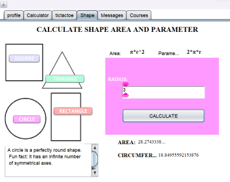
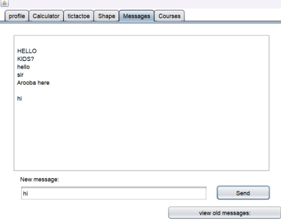
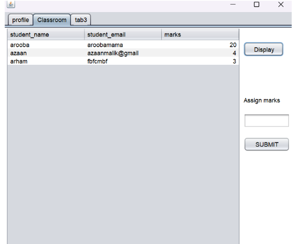

<p align="center">
  
</p>

<h1 align="center">AHU School Application</h1>

<p align="center">
  A Java Swing desktop app for students and teachers: chat, games, calculators, courses and grading in one place.
</p>

## Features

**Everyone**
- Dashboard with school info, admission requirements, scholarships and updates (no login needed)

**Students**
- Sign up / log in
- Profile
- Chatroom (messages saved to a text file)
- Courses and marks
- Calculator, Tic-Tac-Toe, and a shape area/perimeter calculator

**Teachers**
- Log in
- Profile
- View students and assign marks
- Chatroom

## Screenshots

| Dashboard | Shape Calculator |
|---|---|
|  |  |

| Chatroom | Teacher Classroom |
|---|---|
|  |  |

## Tech Stack

- Java (Swing)
- Apache NetBeans 19
- MS Access database via UCanAccess 5.0.1
- Text file for chat storage

## OOP Concepts Used

- Abstraction and inheritance: `Circle`, `Rectangle`, `Square` and `Triangle` extend `Shapes_abstract`
- Encapsulation
- File handling (chatroom)
- Database connectivity
- Exception handling (`try/catch`, `JOptionPane`)

## Getting Started

1. Clone the repo
   ```bash
   git clone [https://github.com/aroobaaaaaaaa/java-school-app/]
   ```
2. Open it in NetBeans
3. Add the UCanAccess JARs to the project libraries
4. Set the `.accdb` database path in the connection class
5. Run the project. The Dashboard opens first.

## Future Work

Assignment submissions, attendance, better grading, a school library, stronger security and an AI chatbot.

## Author

Made by **Arooba**
